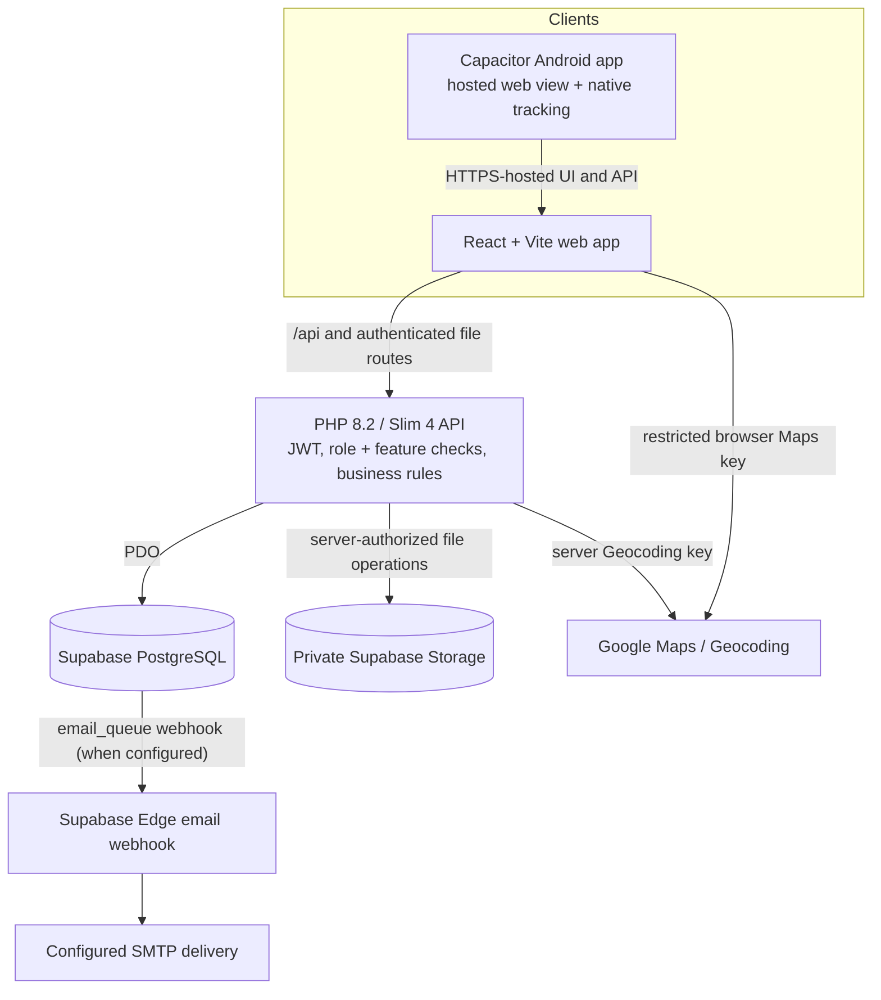

<div align="center">
  

  # ACME HRMS

  **Human resources, workforce attendance, recruitment and branch-origination workflows in one application.**

  A React web client, PHP/Slim API, Supabase-backed data services and a Capacitor Android client.

  [](frontend/package.json)
  [](frontend/package.json)
  [](Dockerfile)
  [](backend/composer.json)
  [](frontend/package.json)

  [**Features**](#workspaces) · [**Architecture**](#architecture) · [**Getting started**](#getting-started) · [**Android**](#android-app) · [**Security & status**](#security-and-project-status) · [**Audit report**](AUDIT_REPORT.md)
</div>

---

> [!IMPORTANT]
> **Development and security status:** The [consolidated audit](AUDIT_REPORT.md) tracks 39 original findings. Its **2026-11-17** snapshot records SEC-001–SEC-020 closed at their documented scopes, while SEC-021–SEC-024, eight performance findings, and seven quality findings remain open (QUAL-002 is partial). Closures include scoped owner-reported verification and accepted residual risks; **they do not constitute blanket production-readiness or an independent penetration-test certification**. Recheck the report and live environment before any real-user release.

## What this repository contains

Acme HRMS is a multi-workspace application for company administrators, employees, HR/managers, applicants and operational teams. The primary browser experience is a React single-page application. The backend implements authentication, authorization, domain APIs, database access and protected file operations in PHP. The Android application uses Capacitor and a native location-tracking service.

| Layer | Implementation | Where to inspect |
| --- | --- | --- |
| Web UI | React 19, React Router 7, Vite 8, Tailwind CSS 4, TanStack Query 5, Axios | [`frontend/package.json`](frontend/package.json), [`frontend/src/App.jsx`](frontend/src/App.jsx) |
| API | PHP 8.2 in Docker, Slim 4, Composer, JWT authentication and route middleware | [`Dockerfile`](Dockerfile), [`backend/composer.json`](backend/composer.json), [`backend/public/index.php`](backend/public/index.php) |
| Data | PostgreSQL hosted through Supabase; versioned SQL migrations | [`backend/src/Config/Database.php`](backend/src/Config/Database.php), [`supabase/migrations`](supabase/migrations) |
| Private files | Supabase Storage accessed through authenticated PHP upload, deletion and file-proxy endpoints | [`backend/public/storage_routes.php`](backend/public/storage_routes.php), [`frontend/src/lib/supabase.js`](frontend/src/lib/supabase.js) |
| Email | Database-backed email queue and a guarded Supabase Edge Function using Nodemailer | [`supabase/functions/send-email`](supabase/functions/send-email), [`backend/src/Security/EmailSecurity.php`](backend/src/Security/EmailSecurity.php) |
| Android | Capacitor 8, Java native foreground location service, protected native session storage | [`frontend/capacitor.config.json`](frontend/capacitor.config.json), [`LocationTrackerService.java`](frontend/android/app/src/main/java/com/example/acmehrms/LocationTrackerService.java) |
| Hosting / CI | Docker image with Apache, Render configuration and GitHub Actions security checks | [`render.yaml`](render.yaml), [`.github/workflows`](.github/workflows) |

## Workspaces

These are **implemented routes and backend capabilities**, not an assertion that every workflow is ready for unrestricted production use.

| Workspace | Code-backed capabilities | Entry points |
| --- | --- | --- |
| **Administration** | Dashboard, employee directory and settings, attendance/geofences/shifts, leave approvals, payroll, expenses, assets, holidays, performance, audit logs, reports, feature access, recruitment, assessments and training | [Admin routes](frontend/src/App.jsx), [PHP admin modules](backend/public/admin_employees_routes.php) |
| **Employees / HR / managers** | Employee dashboard, attendance, profile, leave, expenses, payroll, performance, assessment sessions, assigned training and birthdays; selected admin-layout features are permission-gated | [Employee routes](frontend/src/App.jsx), [employee API](backend/public/employee_attendance_routes.php) |
| **Candidates** | Account activation and login, job browsing, application tracking, document submission and secure download of a linked offer letter | [Candidate pages](frontend/src/pages/CandidateApplications.jsx), [candidate API](backend/public/candidate_recruitment_routes.php) |
| **Loan origination** | Leads, member lookup, loan applications, associated documents, statuses and activities with server-side access restrictions | [Loan routes](backend/public/origination_loans_application_routes.php), [access rules](backend/src/Security/OriginationAccess.php) |
| **Sales origination & branch operations** | Sales leads and activities; branch dashboards, lead views, application review, seen-status and authorized updates | [Sales API](backend/public/origination_sales_leads_routes.php), [branch API](backend/public/branch_operations_application_routes.php) |

The web UI includes desktop and mobile layouts. It also contains employee/admin chatbot endpoints; the optional external Gemini path is restricted to predefined, non-personal FAQ prompts rather than arbitrary HR records ([policy](backend/public/sec004_gemini_security.php)).

## Architecture



**Important implementation details**

- **Authentication authority:** HRMS uses its **PHP-issued JWT and database identity**, not a browser Supabase Auth session. The frontend's Storage adapter calls backend routes rather than issuing anonymous direct Storage writes.
- **Access control:** Protected APIs use role, feature and record/branch checks on the server. Frontend route guards are only an additional UI gate.
- **Sessions:** Normal access tokens are bounded; refresh sessions rotate. Web refresh uses a restricted HttpOnly cookie, while Android uses native secure session storage.
- **Attendance:** Geofence rules apply server-side to configured check-in/check-out cases. Android interval/location punches are a separate roaming tracking workflow.
- **Email:** Recruitment notification types and templates are server-controlled. The Edge endpoint is intended for database webhook delivery, not direct public mailing.
- **Maintenance:** A server-side maintenance middleware restricts protected APIs for non-admin sessions while preserving configured admin recovery paths.

Source: [auth middleware](backend/src/Middleware/AuthMiddleware.php) · [session utilities](backend/src/Utils/RefreshSessions.php) · [geofence policy](backend/src/Security/AttendanceGeofence.php) · [maintenance middleware](backend/src/Middleware/MaintenanceMiddleware.php).

## Repository layout

```text
HRMS/
├── .github/workflows/    # Security, Android and regression CI workflows
├── backend/
│   ├── public/           # Slim entry point, API routes and Apache rewrites
│   └── src/              # Middleware, security helpers, templates, utilities
├── frontend/
│   ├── android/          # Capacitor Android native project and Java tracker
│   ├── public/           # App icons, static assets and Android release files
│   └── src/              # React pages, components, API client and services
├── scripts/              # Restricted, purpose-built maintenance utilities
├── supabase/
│   ├── functions/        # Guarded send-email Edge Function
│   ├── migrations/       # Versioned database changes
│   └── review-only/      # Security review SQL; not normal app startup
├── tests/                # Focused security and regression test fixtures
├── AUDIT_REPORT.md       # Consolidated security, performance, quality audit
├── Dockerfile
├── docker-entrypoint.sh
├── render.yaml
└── README.md
```

## Getting started

### Prerequisites

- **Docker** for the closest match to the repository's container build; or **Node.js 20+**, npm, **PHP with PDO PostgreSQL / cURL extensions**, and Composer for split frontend/backend development. The published container uses Node 20 to build assets and PHP 8.2 with Apache.
- An **existing, appropriately provisioned PostgreSQL/Supabase environment** (schema, migration state, Storage buckets/policies, and development accounts). The repository contains migrations, **not a complete empty-database bootstrap**.
- Your own server credentials and, for optional integrations, correctly restricted Google API keys and email delivery configuration.

> [!CAUTION]
> Use a dedicated development database and test accounts. Do not run reset scripts, apply migrations, purge Storage or change production security settings just to bring up a local instance. Never commit real `.env` files, signing keys or credentials.

### Option A — Docker (recommended for an integrated local preview)

1. Clone the repository.
2. Create a **local, untracked** `.env` in the project root using your development environment's credentials (see [configuration](#configuration)).
3. From the repository root:

```bash
git clone https://github.com/Kondapaneni/HRMS.git
cd HRMS
docker build -t acme-hrms .
docker run --rm --env-file .env -p 8080:80 acme-hrms
```

Open [http://localhost:8080](http://localhost:8080). The multi-stage [Dockerfile](Dockerfile) builds the React assets and serves the SPA and API together through Apache. It does **not** create the database, accounts or Supabase resources.

### Option B — Separate development servers

The Vite development proxy sends `/api` and protected file paths to `http://127.0.0.1:8080` ([config](frontend/vite.config.js)). For this workflow, create an **untracked `backend/.env`** with the applicable backend variables.

**Terminal 1 — API**

```bash
cd backend
composer install
php -S 127.0.0.1:8080 -t public public/index.php
```

**Terminal 2 — React**

```bash
cd frontend
npm ci
npm run dev
```

Open the local Vite URL printed in the terminal. PHP's built-in server is for development; Apache-specific response headers and rewrite behavior should be checked in the Docker deployment.

For a standalone web build:

```bash
cd frontend
npm ci
npm run build
npm run preview
```

A Vite preview of static assets does **not** provision or start the PHP API. Authentication and real business functionality require the backend and database.

## Configuration

The backend reads environment values via [phpdotenv](backend/public/index.php); [`docker-entrypoint.sh`](docker-entrypoint.sh) creates the container's runtime `.env` from available OS environment variables when needed. [`render.yaml`](render.yaml) declares a subset of required deployment secrets. These are **variable names only**, never real values.

| Variable | Purpose |
| --- | --- |
| `DB_HOST`, `DB_PORT`, `DB_DATABASE`, `DB_USERNAME`, `DB_PASSWORD` | PostgreSQL connection used by PHP |
| `JWT_SECRET` | Server-side access-token signing secret |
| `SUPABASE_URL`, `SUPABASE_SECRET_KEY` | Backend Storage integration; secret key **must remain server-side** |
| `FRONTEND_URL`, `CORS_ALLOWED_ORIGINS` | Frontend origin and approved cross-origin requests |
| `GOOGLE_MAPS_BROWSER_API_KEY` | Separately restricted browser Maps JavaScript key, returned only by an authenticated config endpoint |
| `GOOGLE_GEOCODING_API_KEY` | Server-side geocoding; keep separate from the browser key |
| `GOOGLE_MAPS_API_KEY` | Legacy server-side Maps configuration where still required |
| `DB_PDO_PREPARE_MODE`, `SEC018_NATIVE_SESSION_ENABLED` | Database prepare/session-pooler compatibility controls; do not change without validating the target connection |
| `SEC018_DB_USE_RESTRICTED`, `SEC018_DB_USERNAME`, `SEC018_DB_PASSWORD` | Optional restricted database identity |
| `VITE_API_URL` / `VITE_BACKEND_URL` | Frontend API endpoint configuration where applicable; Vite uses `/api` by default on the web |

Additional mailer / integration settings may be needed for a working deployment; inspect the relevant [Edge Function](supabase/functions/send-email/index.ts) and application configuration rather than guessing credentials.

**Safeguards:** Keep `SUPABASE_SECRET_KEY`, `JWT_SECRET`, database passwords and Android signing secrets out of any `VITE_`-prefixed frontend variable, Git commits, screenshots and build logs. Only enable SEC-018 database connection switches after testing the actual pooler and rollback plan ([audit details](AUDIT_REPORT.md#sec-018-remediation-and-verification)).

## API overview

The backend entry point is [`backend/public/index.php`](backend/public/index.php) and registers the per-workspace route modules under [`backend/public/`](backend/public). Representative existing endpoints:

| Purpose | Examples |
| --- | --- |
| Authentication and recovery | `POST /api/login`, `POST /api/auth/otp/send`, `POST /api/auth/otp/verify`, `POST /api/auth/mfa/verify`, `POST /api/auth/refresh`, `POST /api/logout` |
| Current session | `GET /api/me`, `PUT /api/change-password` |
| Employee attendance | `GET /api/employee/attendance`, `POST /api/employee/attendance/punch` |
| Administration | `GET /api/admin/dashboard/stats`, `GET /api/admin/employees`, `POST /api/admin/feature-access`, `GET /api/admin/reports/payroll` |
| Recruitment / candidate | `GET /api/admin/jobs`, `POST /api/candidate/activate`, `GET /api/candidate/applications` |
| Origination | `GET /api/loans/applications`, `GET /api/branch-operations/applications`, sales/lead and activity routes |
| Protected files | `POST /api/storage/upload`, `DELETE /api/storage/object`, and guarded `/Offer-Letter/`, `/Resume/` and other file proxy routes |
| Status / web assets | `GET /api/news`, `GET /version.json` |

**Authorization varies per endpoint**. A valid login does not grant automatic Admin, payroll, cross-branch or candidate-document access. The frontend's route visibility is not a substitute for backend authorization.

## Android app

The Android project lives under [`frontend/android/`](frontend/android); [Capacitor configuration](frontend/capacitor.config.json) points the native WebView at a configured HTTPS-hosted HRMS URL. It is **not an independently bundled offline server**.

- Attendance background updates use a Java **foreground location service** with notification, location and battery-permission handling ([service](frontend/android/app/src/main/java/com/example/acmehrms/LocationTrackerService.java), [plugin](frontend/android/app/src/main/java/com/example/acmehrms/LocationTrackerPlugin.java)).
- The recurring tracking interval comes from application settings, with a **15-minute fallback** in the client; individual testing may temporarily use shorter intervals. The service is intended to operate during an active check-in and stop after checkout, subject to Android permissions and OS behavior.
- Native refresh credentials are transferred into Keystore-backed handling ([native session adapter](frontend/src/api/nativeSession.js)); the browser uses a different refresh-cookie path.
- `npm run cap:sync` builds and syncs the web assets to the Android project; `npm run cap:open` opens Android Studio. The `cap:apk` npm script invokes `gradlew.bat` and is Windows-oriented.
- [Android CI](.github/workflows/sec006.yml) builds test artifacts; public employee-profile APK download is gated by a **verified signed release manifest** in `frontend/public/downloads/android-release.json`. Do not assume that any local debug APK is a valid in-place upgrade.

```bash
cd frontend
npm ci
npm run cap:sync
npm run cap:open
```

Releasing an APK with a different signing certificate can require a coordinated uninstall/reinstall migration. The consolidated [APK signing and rollout guide](AUDIT_REPORT.md#android-apk-distribution-and-signing-guide) documents the existing flow. Avoid uploading signing keys or distributing unsigned builds as production releases.

## Quality checks and change control

The repository has focused source, HTTP, database-fixture, frontend and Android security regressions in [`tests/`](tests), orchestrated by [GitHub Actions](.github/workflows). Some database tests deliberately use **isolated PostgreSQL fixtures** and must not target real HRMS data.

Useful source-level commands already exercised by repository workflows:

```bash
# From the repository root (Node.js and PHP available)
node --test tests/sec006_android_security_test.mjs
node tests/sec019_source_test.mjs
php tests/sec019_employee_id_test.php

# Frontend checks
cd frontend
npm ci
npm run build
npm run lint
```

The commands above are **available**, not a claim that every check currently passes in every environment. For database/HTTP suites, follow the corresponding workflow's exact setup and guard conditions. In particular, never run SEC-019 dev-reset utilities as routine tests.

Security changes follow [the documented one-issue-per-PR/squash policy](AUDIT_REPORT.md#security-change-control-and-historical-mapping). Reviews, required CI, staging tests and release approval are separate gates; do not rewrite published `main` history to tidy commit logs.

## Security and project status

The implementation includes JWT/session and MFA protections, role/feature authorization, server-side record ownership checks, guarded file proxies, explicit CORS policy, maintenance gating and targeted security regression workflows. **These mechanisms have limitations and should not be described as comprehensive security certification.**

The [consolidated audit report](AUDIT_REPORT.md) is the authoritative issue-by-issue history. Its 2026-11-17 snapshot identifies:

- **20 scoped security closures** (SEC-001–SEC-020), based on source, CI and the indicated owner-confirmed live checks.
- **Open:** SEC-021–SEC-024, PERF-001–PERF-008 and QUAL-001–QUAL-007; QUAL-002 is partially improved.
- **Residual release work:** backup/restore recovery evidence for SEC-018 was not verified, historical secret/queued-credential considerations remain, and other release gates are separate from issue closure.

For security concerns, avoid sharing tokens, personal records, signing material or exploit payloads in public issues. Coordinate privately with repository maintainers. **No production-readiness assertion or uptime guarantee is made here.**

## Deployment and maintenance

- [`render.yaml`](render.yaml) declares a Docker-backed Render web service tracking `main`. The [Dockerfile](Dockerfile) builds frontend assets with Node and runs PHP 8.2/Apache for the API and SPA.
- The [Capacitor config](frontend/capacitor.config.json) and [email-link helper](backend/src/Security/EmailSecurity.php) refer to `https://hrms-qwv3.onrender.com`. That is a **configured host**, not independently verified availability or production clearance.
- Database changes live in [`supabase/migrations/`](supabase/migrations); approval, backups, migration history verification and target-environment selection are deployment responsibilities.
- React emits a version file ([Vite config](frontend/vite.config.js)), while maintenance is enforced server-side for protected API calls ([middleware](backend/src/Middleware/MaintenanceMiddleware.php)).

## Documentation and usage

The repository's complete security remediation, testing history, Android signing notes, candidate offer-letter download design, employee ID format and change-control policy are consolidated in **[AUDIT_REPORT.md](AUDIT_REPORT.md)**. The README intentionally gives an approachable, current code map instead of duplicating hundreds of pages of historical findings.

**Source review:** This README was checked against repository commit [`4df0af4`](https://github.com/Kondapaneni/HRMS/commit/4df0af4d16232fdc65b6038263b25494d38ebad4) on **2026-11-17**. Source and deployed environments can change; verify the current commit, migrations, CI results and operational settings before relying on any claim. No `LICENSE` file was present in that reviewed tree; confirm redistribution terms with the maintainer.
